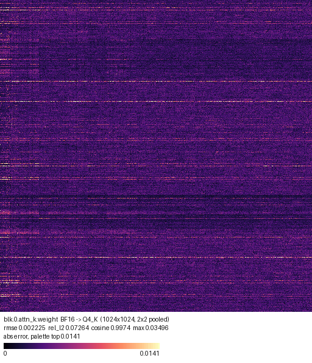
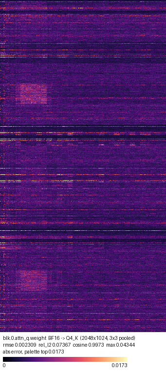
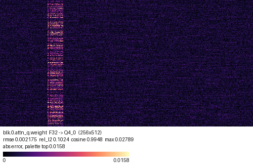
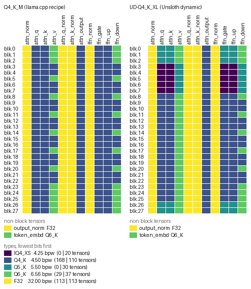
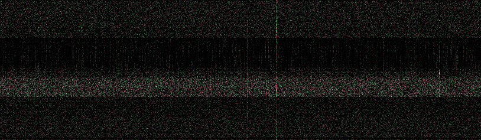

# ggufkit

Fingerprint, verify and visualize [GGUF](https://github.com/ggml-org/ggml/blob/master/docs/gguf.md) models.

`ggufkit` answers questions a plain file hash cannot:

- Is this GGUF the same model as that one, even though the bytes differ?
- Did a re-upload change the weights, or only the metadata? Which keys, which tensors?
- Does this file document where it came from well enough to reproduce it?
- How far is this quantization from its source, tensor by tensor, and where inside each tensor?
- Which quantization type did each tensor get?
- What does `blk.17.attn_q.weight` actually look like?

It is built on llama.cpp's own [`gguf`](https://pypi.org/project/gguf/) Python package, so
every tensor type that package can decode works here too: 26 of them, from `Q4_0` to
`IQ2_XXS` and `MXFP4`. Sharded models (`-00001-of-00003.gguf`) are handled as one model.



*Where 4-bit quantization loses precision: `ggufkit viz error` on `blk.0.attn_k.weight` of
Qwen3-0.6B, comparing Unsloth's BF16 and Q4_K_M files. Error follows weight magnitude: bright
rows are output channels with large weights, whose 4-bit steps are coarser (per-row correlation
between error and weight magnitude: 0.99).*

Every example below is real output on
[unsloth/Qwen3-0.6B-GGUF](https://huggingface.co/unsloth/Qwen3-0.6B-GGUF) (Apache-2.0) at
revision `50968a4`. [`scripts/make_readme_assets.py`](scripts/make_readme_assets.py) downloads
the three files, checks their sha256 and reruns every command.

## Why

Model signing ([OpenSSF model-signing](https://github.com/sigstore/model-transparency),
Sigstore) protects the bytes you were given. It breaks the moment someone fixes a chat
template in the metadata, and when it breaks it cannot tell you whether the weights changed.
It also says nothing about whether a community quantization was faithfully built from the
model it names: a 2026 study of the most-downloaded GGUF repositories on Hugging Face found
that none record enough build inputs to reproduce the quantization, and
[Mind the Gap](https://arxiv.org/abs/2505.23786) (ICML 2025) showed weights that behave
well in full precision and badly after GGUF quantization.

ggufkit gives GGUF files a content identity that survives the edits people legitimately make
([docs/FINGERPRINT.md](docs/FINGERPRINT.md)), a provenance record that says what a file claims
and what it leaves out ([docs/MANIFEST.md](docs/MANIFEST.md)), and the tools to check one
against the other.

## Install

```sh
pip install 'ggufkit[viz] @ git+https://github.com/MysterionRise/ggufkit'   # until the first PyPI release
uv tool install 'ggufkit[viz] @ git+https://github.com/MysterionRise/ggufkit'
```

The `viz` extra pulls in Pillow for image rendering; the core needs only `gguf` and `numpy`.
Python 3.10 or newer.

## Quick start

### Fingerprint a model

```console
$ ggufkit fingerprint Qwen3-0.6B-Q4_K_M.gguf --no-per-tensor
kv           8eb7cd5593931521f2e20641dcb340cf5e9e32a6cafd9b5face98332e53052d9
tensor_info  fb9deeab22c4fb9d0b1cca92f9edb974c1f21c53b1a986cd96144d665f0c65be
weights      b69d967169c1d061f65f21e5208091993f949bb274a91c1cacf9f1318fdb6c6c
overall      9aa16655466361e4dfa7dc91181db38229f51914038c7de77c5fe4b3dfd7a8a9
spec         ggufkit-fp/1  (32 metadata entries, 310 tensors)
```

Three digests, three answers:

| `kv` | `tensor_info` | `weights` | meaning |
|---|---|---|---|
| same | same | same | the same model |
| differs | same | same | only metadata changed (names, templates, licence text) |
| same | differs | same | tensors renamed or retyped in place, bytes untouched |
| any | any | differs | tensor bytes changed, or tensors were added or removed |

Without `--no-per-tensor` you also get one line per tensor. `--json` prints JSON, `--no-data`
skips tensor bytes (instant on any size), `--per-kv` adds a digest per metadata entry, `-j 8`
hashes on eight threads. Pass any shard of a split model and
the whole model is fingerprinted; splitting, merging or editing metadata with llama.cpp's
`gguf_new_metadata` leaves `weights` unchanged.

### Record provenance

```console
$ ggufkit manifest Qwen3-0.6B-Q4_K_M.gguf --file-sha256
manifest     Qwen3-0.6B-Q4_K_M.manifest.json
model        qwen3 Q4_K_M, 310 tensors, 596.05M parameters, 372.65 MiB
fingerprint  9aa16655466361e4dfa7dc91181db38229f51914038c7de77c5fe4b3dfd7a8a9
provenance   imatrix, quantized_by, repo_url
score        2/9 of what a verifiable file records
gaps         general.source.*, general.license, general.uuid, build_inputs.source_sha256, build_inputs.imatrix_sha256, build_inputs.llama_cpp_commit, build_inputs.quantize_cmd
```

This file records who quantized it and which calibration data the importance matrix came from,
but not which model it was quantized from, its licence, or how to rebuild it.

The manifest is a JSON file: the full fingerprint, file sizes (and raw hashes with
`--file-sha256`), what the metadata claims about origin and licence, the build inputs you pass
with `--input KEY=VALUE`, and the list of what a reproducible quantization would record but
this file does not. Its producer can close the `build_inputs.*` gaps with `--input`, for
example `--input llama_cpp_commit=b8146`. Publish it next to the model.

To sign it, `--intoto model.intoto.json` also writes an in-toto statement, and the manifest
works as a predicate for `cosign attest-blob`. The tested recipe is in
[docs/MANIFEST.md](docs/MANIFEST.md#signing).

### Verify

A copy whose name was changed with llama.cpp's `gguf-new-metadata`, checked against the
manifest of the original:

```console
$ ggufkit verify edited/Qwen3-0.6B-Q4_K_M.gguf --manifest Qwen3-0.6B-Q4_K_M.manifest.json
verdict      metadata-only
kv           differs
tensor_info  same
weights      same
metadata changes:
  ~ general.name
```

Unsloth's two 4-bit files of the same model, compared directly:

```console
$ ggufkit verify Qwen3-0.6B-UD-Q4_K_XL.gguf --against Qwen3-0.6B-Q4_K_M.gguf
verdict      weights-changed
kv           same
tensor_info  differs
weights      differs
tensor changes:
  ~ blk.0.attn_k.weight  retyped  Q5_K -> Q4_K
  ~ blk.0.attn_q.weight  retyped  Q5_K -> Q4_K
  ~ blk.0.ffn_gate.weight  retyped  Q5_K -> Q4_K
  ~ blk.0.ffn_up.weight  retyped  Q5_K -> Q4_K
  …
```

`kv same`: the two files carry identical metadata, down to `general.file_type`, which says
`Q4_K_M` in both. Only the tensors tell them apart: 60 of them are stored in a different type.

Verify against a manifest or straight against another file with `--against other.gguf`. The
verdict is one of `identical`, `metadata-only`, `tensor-info-only`, `metadata-and-tensor-info`
or `weights-changed`. The exit status is 0 only for `identical`, so it drops into CI and
download scripts; `--allow-metadata` also accepts `metadata-only`, and `--ignore-keys` takes
globs for keys you expect to change.

### Diff two models

```console
$ ggufkit diff Qwen3-0.6B-BF16.gguf Qwen3-0.6B-Q4_K_M.gguf --no-kv --numeric --top 8
tensors: 197 changed, 0 added, 0 removed (of 310)
  ~ blk.0.attn_k.weight  type, data  [BF16 1024x1024 -> Q4_K 1024x1024]
  ~ blk.0.attn_output.weight  type, data  [BF16 2048x1024 -> Q4_K 2048x1024]
  …
  ~ token_embd.weight  type, data  [BF16 1024x151936 -> Q6_K 1024x151936]
numeric (top 8 by rel_l2):
  tensor                               a -> b                 rmse    max_abs   mean_abs     rel_l2     cosine
  blk.16.ffn_down.weight               BF16->Q4_K         0.001822   0.023621   0.001476   0.076444   0.997074
  blk.19.ffn_down.weight               BF16->Q4_K         0.002015   0.029144   0.001633   0.076084   0.997102
  blk.18.ffn_down.weight               BF16->Q4_K         0.001898   0.024334   0.001547   0.075795   0.997124
  blk.15.ffn_down.weight               BF16->Q4_K         0.001775   0.031386   0.001440   0.075282   0.997163
  blk.16.attn_k.weight                 BF16->Q4_K         0.001789   0.028889   0.001346   0.075218   0.997169
  blk.10.ffn_down.weight               BF16->Q4_K         0.001768   0.021751   0.001437   0.074827   0.997197
  blk.11.attn_output.weight            BF16->Q4_K         0.001742   0.020073   0.001346   0.074776   0.997201
  blk.13.attn_output.weight            BF16->Q4_K         0.001683   0.016928   0.001350   0.074690   0.997207
```

The whole 596M-parameter comparison takes under a minute. Across the model, tensors stored as
Q4_K land at a median relative L2 error of 7.3%, the Q6_K ones at 1.8%.

Metadata entries are shown with their old and new values; tensors are listed as added,
removed or changed (shape, type, data). `--numeric` decodes both sides and reports error per
tensor, worst first, in bounded memory. `--tensor 'blk.*.attn_*'` narrows it, `--json` gives
machine-readable output, and the exit status is 1 when anything differs.

### See where quantization loses precision

```sh
ggufkit viz error Qwen3-0.6B-BF16.gguf Qwen3-0.6B-Q4_K_M.gguf blk.0.attn_q.weight -o err.png --max-pixels 262144
ggufkit viz error Qwen3-0.6B-BF16.gguf Qwen3-0.6B-Q4_K_M.gguf 'blk.*.attn_q.weight' --match-glob --shared-scale -o imgs/err.png
```



*`blk.0.attn_q.weight`, Q4_K against BF16. Besides the bright rows, a brighter patch stands
out a quarter of the way down, in the rows of attention heads 3 to 5: its weights are about 40%
larger than the tensor's average, and its error about 60% larger.*



*A synthetic illustration of the mechanism, from `scripts/make_examples.py`: one input channel
with 8x larger weights, quantized to Q4_0. Q4_0 stores one scale per block of 32 weights along
a row, so the outlier stretches the scale of its block and every weight in that band loses
precision.*

Each pixel is the error of one weight: absolute by default, `--metric rel` or `--metric signed`
on request. Large tensors are pooled down to `--max-pixels` while they are decoded, and the
default `--pool max` keeps the worst weight of each pixel visible. The caption gives rmse,
relative L2 and cosine similarity; `--shared-scale` puts several tensors on one colour scale.

### See the quant mix

```console
$ ggufkit viz layers Qwen3-0.6B-UD-Q4_K_XL.gguf
block  attn_norm  attn_q  attn_k  attn_v  attn_q_norm  attn_k_norm  attn_output  ffn_norm  ffn_gate  ffn_up  ffn_down
0      F32        Q5_K    Q5_K    Q6_K    F32          F32          Q4_K         F32       Q5_K      Q5_K    Q6_K
…
3      F32        IQ4_XS  IQ4_XS  Q5_K    F32          F32          Q4_K         F32       IQ4_XS    IQ4_XS  Q5_K
…
$ ggufkit viz layers Qwen3-0.6B-Q4_K_M.gguf Qwen3-0.6B-UD-Q4_K_XL.gguf -o layers.png
```



*The two 4-bit files from the verify example. llama.cpp's Q4_K_M recipe (left) raises `attn_v`
and `ffn_down` to Q6_K in the first three blocks, every third block after that and the last
five. Unsloth's UD-Q4_K_XL (right) uses Q5_K for the first three and last two blocks, IQ4_XS
for blocks 3 to 7, and Q6_K for `attn_v` outside blocks 3 to 7. The metadata of both files
says Q4_K_M.*

One row per block, one column per tensor role, coloured by bits per weight, with non-block
tensors and a legend underneath. Given several models, `-o` draws them side by side with one
palette, so a colour means the same type in every panel. The text table and `--json` work
without Pillow.

### Stitch metadata onto tensors

```sh
ggufkit stitch --metadata tokenizer-fixed.gguf --tensors model.gguf -o model-fixed.gguf
ggufkit stitch --metadata model.gguf -o vocab-only.gguf     # metadata only, no tensors
```

### Look at the weights

```sh
ggufkit viz tensor model.gguf blk.0.attn_q.weight -o attn_q.png
ggufkit viz tensor model.gguf 'blk.*.attn_q.weight' --match-glob -o imgs/q.png
ggufkit viz tensor model.gguf token_embd.weight -o embd.png --max-pixels 4000000
```

Each pixel is one weight: brightness follows magnitude, hue says whether the weight sits
well below the mean, well above it, or in between. A slice of an `attn_q` tensor from a 3B
model:



PyTorch checkpoints work too when `torch` is installed (`--model-type torch`).

## What this proves, and what it does not

A fingerprint proves integrity and equivalence: that two files hold the same metadata,
descriptors and weights, or exactly which part differs. A manifest records claims and makes
their absence visible. Neither proves that a quantized file was faithfully derived from the
model it names, or that a model is benign. For that, re-quantize the source with the recorded
build inputs and compare: `ggufkit verify --against` tells you whether you reproduced the
file, and `ggufkit diff --numeric` tells you how far apart the two are when you did not.

## Roadmap

- A gallery of error maps and quant maps for popular open models, built from the real files.
- in-toto statements from manifests, for signing with `cosign` or `model_signing`.
- A one-shot "reproduce this quant" check that drives `llama-quantize` from a manifest.

## Development

```sh
uv sync --all-extras
uv run pytest
uv run ruff check . && uv run ruff format --check .
uv run mypy
```

Tests build tiny GGUF files in-process; nothing is downloaded. `pytest --update-golden`
rewrites the golden fingerprint after a deliberate spec change (bump the spec id too).
Releases are published to PyPI by pushing a `vX.Y.Z` tag that matches `pyproject.toml`.

## Origins

ggufkit started from [KerfuffleV2/gguf-tools](https://github.com/KerfuffleV2/gguf-tools)
(MIT, 2023): `gguf-checksum`, `gguf-frankenstein` and `gguf-tensor-to-image`. Those commits
are preserved in this repository's history. The checksum tool's idea, hashing metadata,
tensor descriptors and weights separately and independent of their order, is the seed of
the fingerprint specification.

## License

MIT. See [LICENSE](LICENSE).
